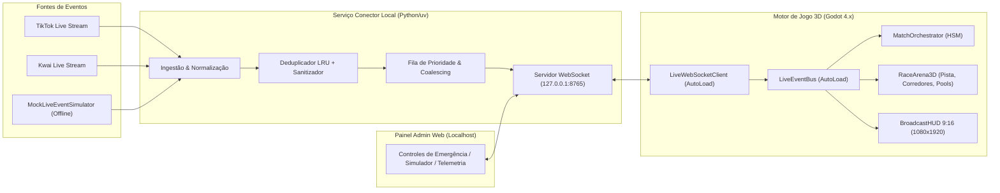

# ARCHITECTURE.md — Arquitetura do Sistema (Corrida dos Candidatos)

---

## 1. Visão Geral de Alto Nível

O sistema é dividido em três processos desacoplados que se comunicam localmente via WebSocket JSON (`ws://127.0.0.1:8765`), garantindo que oscilações na rede do TikTok/Kwai jamais congelem o loop físico de 60 FPS do motor 3D:



---

## 2. Estrutura de Diretórios do Projeto

```text
C:\Users\Kanex\OneDrive\Desktop\JOGI\
├── .agents/                    # Customizações locais do Antigravity (skills, agents, rules, workflows, plugins)
├── assets/                     # Modelos 3D (.glb), texturas, áudios e fontes
│   ├── models/
│   │   ├── candidates/         # Avatares 3D gerados/rigados via Tripo CLI
│   │   └── props/              # Obstáculos e elementos modulares da pista
│   ├── audio/                  # Música, locução e efeitos sonoros
│   └── fonts/                  # Fontes broadcast e tabulares
├── data/                       # Godot Resources (.tres) editáveis e determinísticos
│   ├── candidates/             # Perfis dos candidatos (CandidateProfileResource)
│   ├── gifts/                  # Mapeamento de presentes (GiftEffectResource)
│   └── tracks/                 # Configurações das pistas
├── scenes/                     # Cenas Godot 4 (.tscn)
│   ├── main/                   # Cena raiz e orquestração
│   ├── arena/                  # Pista 3D, iluminação, câmera de transmissão
│   ├── entities/               # CandidateRunner.tscn, obstáculos e efeitos em pool
│   └── hud/                    # BroadcastHUD 9:16, placar, alertas de presentes, pódio
├── scripts/                    # Scripts GDScript 2.0 estaticamente tipados (.gd)
│   ├── autoloads/              # LiveEventBus, GameConfig, MatchOrchestrator, AudioDirector
│   ├── state_machine/          # HSM para partida e para corredores
│   ├── entities/               # Controladores físicos CharacterBody3D
│   └── network/                # Cliente WebSocket local resiliente
├── services/                   # Serviços auxiliares fora do Godot
│   ├── live_bridge/            # Conector Python (TikTok, Kwai, Simulador, Fila, WS)
│   └── admin_panel/            # Painel Web de controle e telemetria local
└── tests/                      # Testes automatizados (GDScript headless, pytest, Playwright)
```

---

## 3. Contratos de Comunicação (`LiveEventEnvelope`)

Todo evento enviado do `LiveBridge` (ou do `MockLiveEventSimulator`) para o Godot segue um envelope JSON estrito:

```json
{
  "schema_version": "1.0",
  "event_id": "evt_20261018_9f8a7b6c",
  "timestamp_ms": 1792345678000,
  "source": "tiktok | kwai | simulator | admin",
  "event_type": "vote_comment | like_batch | gift_action | share_boost | admin_command",
  "actor": {
    "user_id": "usr_12345",
    "display_name": "Torcedor_BR",
    "avatar_url": ""
  },
  "payload": {
    "target_candidate_id": "cand_01",
    "action_id": "boost_tier_1",
    "intensity": 1.0,
    "combo_count": 1
  }
}
```

---

## 4. Decisões Arquiteturais Chave (ADRs)

1. **Isolamento do Conector de Live em Processo Python Separado (`services/live_bridge`)**:
   - Bibliotecas de scraping/WebCast de TikTok e Kwai sofrem atualizações frequentes de protocolo. Isolar a ingestão em Python (gerenciado via `uv`) mantém o cliente Godot 4 limpo, consumindo apenas o contrato `LiveEventEnvelope` via WebSocket local.
2. **Automação Headless via `gda` (`aigengame/godot-agent`)**:
   - Criação, inspeção e validação de cenas `.tscn` e scripts `.gd` são verificadas via CLI (`gda scene validate`, `gda script validate`, `gda scene preflight`), evitando corrupção manual de arquivos de cena.
3. **Object Pooling Obrigatório na Arena 3D**:
   - Efeitos visuais de presentes e obstáculos dinâmicos são pré-alocados no carregamento da arena e reciclados no reset de cada partida, garantindo estabilidade de memória em lives de longa duração.
