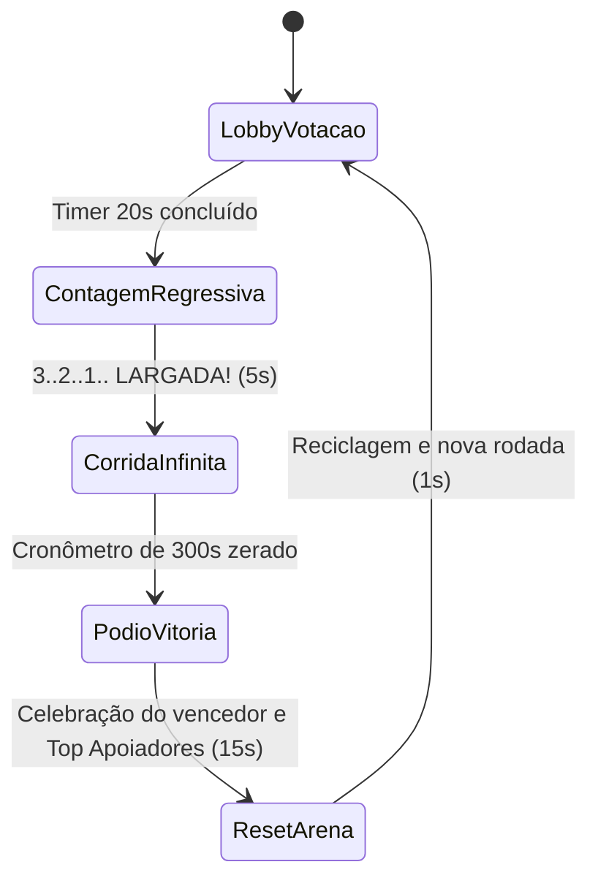

# GAME_DESIGN.md — Regras do Jogo e Loop de Live: Lula vs. Bolsonaro (Corrida Infinita)

---

## 1. Conceito Central e Loop de Engajamento

**Corrida dos Candidatos** é uma sátira política esportiva interativa 3D desenvolvida para transmissões contínuas no **TikTok LIVE** e **Kwai LIVE**.
A disputa ocorre exclusivamente entre **Lula** (#1, Coral/Vermelho) e **Bolsonaro** (#2, Azul Elétrico), transformando a polarização das redes em uma competição interativa, bem-humorada e visualmente clara.

Em vez de uma corrida curta com pórtico fixo que reinicia a cada minuto, a corrida é **infinita e contínua**, com duração por cronômetro de partida (padrão de **5 minutos / 300 segundos**). Vence o candidato que tiver acumulado a **maior distância percorrida em metros** quando o cronômetro zerar.

---

## 2. Ciclo Automatizado da Partida (5 Minutos)

1. **Lobby de Aquecimento (`20s`)**: Lula e Bolsonaro alinhados nas duas raias. Apoiadores votam nos comentários (`#1`, `#lula`, `#2`, `#bolsonaro`) para acumular bônus de largada.
2. **Contagem Regressiva (`5s`)**: Enquadramento dinâmico dos dois corredores na pista; luzes de largada acendem.
3. **Corrida Infinita Ativa (`300s` / 5 Minutos)**:
   - Os dois corredores correm continuamente no sentido `-Z`.
   - A pista 3D é infinita, composta por 8 blocos modulares (*chunks*) de 40m que são continuamente reciclados para a frente conforme os competidores avançam.
   - O placar e a barra central **Tug-of-War** exibem em tempo real a vantagem em metros (`+35.4m LULA NA FRENTE` ou `+22.1m BOLSONARO NA FRENTE`).
4. **Pódio da Vitória (`15s`)**: Ao término dos 5 minutos, a corrida é encerrada, apurando o campeão pela maior quilometragem acumulada, com comemoração temática e exibição dos maiores apoiadores da rodada.
5. **Reset Automático (`1s`)**: Limpeza de contadores, reposicionamento suave na largada e início imediato do próximo ciclo 24/7.

---

## 3. Os Dois Competidores (Slot 1 & Slot 2)

| Slot | Candidato | Cor Oficial | Sátira e Visual Caricato 3D | Comandos de Voto |
|---|---|---|---|---|
| **#1** | **Lula** | `#FF3B5C` (Coral/Vermelho) | Cabeça arredondada, cabelo grisalho ondulado e **barba cheia branca/grisalha procedural** no queixo e mandíbula; camisa/terno vermelho. | `#1`, `#lula`, `lula`, `13`, `#pt` |
| **#2** | **Bolsonaro** | `#00A8FF` (Azul Elétrico) | Cabelo liso com corte partido de lado, sem barba, terno azul escuro e **faixa presidencial diagonal verde-amarela** no peito. | `#2`, `#bolsonaro`, `bolsonaro`, `22`, `#pl` |

> [!IMPORTANT]
> **Zero Poluição Visual 3D**: Nenhum texto flutuante (`Label3D`) é renderizado acima da cabeça dos corredores. Toda a leitura de nomes, posições, distância e telemetria é realizada na interface 2D (`CanvasLayer`) vertical 9:16.

---

## 4. Mapa de Interações da Live -> Mecânicas no Jogo

### 4.1 Interações Gratuitas (Retenção e Volume de Chat)

| Evento na Live | Como o Espectador Aciona | Efeito na Corrida | Regras / Limites |
|---|---|---|---|
| **Comentário de Voto** | Digitar `#1`, `#2`, `#lula`, `#bolsonaro` | Incrementa o contador de votos e concede mini-impulso de velocidade (`+0.8 m/s` por `1.5s`) | Rate-limit e deduplicação LRU por usuário |
| **Rajada de Curtidas (Likes)** | Tocar na tela da live | Enche o medidor de torcida do candidato; a cada 50 likes acumulados, dispara impulso de torcida | Agregado em lotes |
| **Compartilhamento (Share)** | Compartilhar a transmissão | Concede impulso de recuperação (*Catch-up*) se o candidato estiver atrás | Cooldown de 5s |

### 4.2 Presentes / Moedas (Caos Satírico, Ataques e Defesas)

| Tier | Presente Exemplo | Efeito Primário | Mecânica no Jogo |
|---|---|---|---|
| **Tier 1 (Micro)** | Rosa (1 moeda) | **Rosa Impulso** | Turbo imediato (`+3.5 m/s` por `3.5s`) para o candidato escolhido. |
| **Tier 2 (Médio)** | Rosquinha (15 moedas) | **Rosquinha Blindada (Escudo)** | Ativa campo de força protetor azul/dourado por `5.0s`. Enquanto ativo, anula impactos de obstáculos. |
| **Tier 3 (Pesado - Ataque)** | Papel / Processo (100 moedas) | **Pilha de Processos / Documentos** | **Ataque Político**: Instancia uma pilha de documentos/processos judiciais 3D diretamente na raia do adversário à frente. Se o adversário não tiver escudo ativo, sofre tropeço e perde velocidade por `2.0s`. Se tiver escudo, o impacto é absorvido sem perda de velocidade. |
| **Tier 4 (Épico)** | Super Comício (500 moedas) | **Super Comício** | Super Turbo (`+8.0 m/s` por `8.0s`) + Escudo de Invulnerabilidade completo. |

---

## 5. Pista Infinita Procedural e Câmera

1. **Reciclagem de Chunks**: A pista é composta por 8 módulos de 40 metros (`total_span = 320m`). Conforme o líder avança em `-Z`, blocos que ficam mais de 50 metros para trás são movidos instantaneamente 320 metros à frente, criando uma pista infinita sem interrupções.
2. **Câmera 9:16 Dinâmica**: Posicionada a `Vector3(0.0, 7.0, 11.0)` em relação ao ponto médio entre Lula e Bolsonaro, com enquadramento proporcional que mantém ambos os candidatos visíveis na zona segura da transmissão vertical.
3. **Barra Tug-of-War no HUD**: O HUD 2D apresenta uma barra central de disputa de cabo de guerra:
   - No centro (`50%`): Competidores empatados (`⚔️ EMPATADOS`).
   - Lula na frente: Barra desliza para a esquerda (`🚩 +35.4m LULA NA FRENTE` em `#FF3B5C`).
   - Bolsonaro na frente: Barra desliza para a direita (`🚩 +22.1m BOLSONARO NA FRENTE` em `#00A8FF`).
