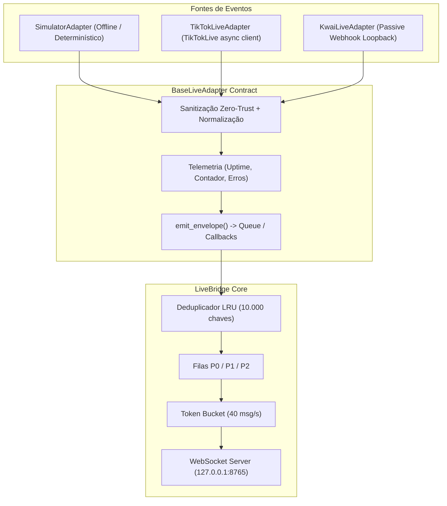

# Adaptadores Modulares de Live — Corrida dos Candidatos

Este diretório contém a arquitetura de adaptadores modulares para captura, normalização e ingestão de eventos ao vivo para o jogo 3D **Corrida dos Candidatos**.

---

## 1. Arquitetura Modular Desacoplada

Todos os conectores herdam de [`BaseLiveAdapter`](base.py) (`abc.ABC` + `@dataclass`), padronizando o ciclo de vida, contagem de métricas de telemetria e o encaminhamento de eventos sanitizados via Zero-Trust:



### Contrato Base (`BaseLiveAdapter`)
- `async def start(self) -> None`: Inicia tarefas em segundo plano ou conexão de rede.
- `async def stop(self) -> None`: Encerramento gracioso e cancelamento de tarefas.
- `def is_connected(self) -> bool`: Status atual de conexão.
- `def get_stats(self) -> dict[str, Any]`: Métricas estruturadas de telemetria.
- `async def emit_envelope(self, envelope: dict[str, Any]) -> None`: Distribuição para fila assíncrona ou callbacks registrados (`on_event`).

---

## 2. Adaptador Simulador (`SimulatorAdapter`)

Projetado para **desenvolvimento e testes 100% autônomos, determinísticos e sem conexão com a internet**. Não depende de bibliotecas externas nem credenciais de live.

### Perfis de Carga Contínua

| Perfil | Taxa | Intervalo | Propósito |
|---|---|---|---|
| `calm` | 2 msg/s | ~500 ms | Validação de transições lentas de HUD e física básica |
| `typical_live` | 15 msg/s | ~66.7 ms | Ritmo de transmissão orgânica com comentários e curtidas |
| `viral_storm` | 100 msg/s | ~10 ms | Stress test do Token Bucket e coalescing de pacotes |
| `normal` | 25 msg/s | ~40 ms | Compatibilidade com testes legados |
| `burst` | 200 msg/s | ~5 ms | Teste de estouro de fila e capacidade do Godot |
| `chaos_fuzz` | 40 msg/s | ~25 ms | Fuzzing de caracteres Unicode, bidi e tags BBCode |

### Exemplos de Uso

#### Modo sob demanda / manual:
```python
from adapters import SimulatorAdapter

sim = SimulatorAdapter()
await sim.start()

# Emite um voto no candidato 3
envelope = await sim.simulate_event(event_type="vote", candidate_slot=3)

# Emite uma rajada de 20 eventos
burst = await sim.simulate_burst(count=20)
await sim.stop()
```

#### Modo contínuo em segundo plano:
```python
sim = SimulatorAdapter(profile="typical_live", continuous=True)
sim.on_event(lambda env: print("Evento recebido:", env["event_type"]))
await sim.start()

# Deixe rodar pelo tempo desejado...
await asyncio.sleep(5)
await sim.stop()
```

---

## 3. Adaptador TikTok LIVE (`TikTokLiveAdapter`)

Conecta-se a transmissões públicas do TikTok LIVE utilizando a biblioteca comunitária assíncrona `TikTokLive`.

### Recursos Implementados
1. **Import Dinâmico e Seguro**: Se `TikTokLive` não estiver instalado, o adaptador inicializa em modo seguro `DISABLED_NO_LIB` sem travar a aplicação nem interromper o servidor.
2. **Sanitização Zero-Trust**:
   - `CommentEvent`: Extrai apenas o slot de voto (`#1` a `#6`). **O texto livre do chat nunca é transmitido ao Godot** (mitigação de injeção de BBCode/XSS conforme `SECURITY.md`).
   - `LikeEvent`: Coleta o volume de curtidas e gera `build_like_batch_envelope`.
   - `GiftEvent`: Utiliza `GiftStreakTracker` de `protocol.py` para deduplicar combos (streaks) incrementais (1 -> 3 -> 5), garantindo que apenas os deltas positivos sejam emitidos.
   - `ShareEvent`: Gera pacotes de compartilhamento com boost para os corredores.
3. **Resiliência e Reconexão**: Backoff exponencial com full jitter (`delay = min(30.0, 1.0 * (2 ** attempt)) + random(0, 0.5)`).
4. **Zero Credenciais**: Não utiliza senhas, tokens de API ou cookies de sessão. Apenas o nome de usuário público `@username` da sala é necessário.

### Como Ativar em Produção
No terminal do projeto (usando `uv`):
```bash
# 1. Instalar a biblioteca no ambiente virtual isolado
uv add TikTokLive

# 2. Configurar o adaptador no seu inicializador
from adapters import TikTokLiveAdapter, TikTokAdapterConfig

config = TikTokAdapterConfig(unique_id="nome_do_canal_da_live", enabled=True)
tiktok_adapter = TikTokLiveAdapter(config=config)
await tiktok_adapter.start()
```

---

## 4. Adaptador Kwai LIVE (`KwaiLiveAdapter`)

### Contexto e Limitações da Plataforma
> [!IMPORTANT]
> **Ausência de API Oficial Aberta**: Ao contrário do TikTok, o **Kwai não disponibiliza uma API pública oficial de WebCast** para captura programática de eventos de transmissões ao vivo.
> 
> Para evitar técnicas frágeis de scraping ou violação de termos de serviço, o `KwaiLiveAdapter` adota uma arquitetura **passiva via Webhook loopback local**.

### Modo de Operação
- **Padrão**: Desativado por segurança (`status: DISABLED_NO_API`, `enabled: False`).
- **Ativação Passiva**: Quando `enabled=True`, abre um servidor HTTP local estritamente vinculado a `127.0.0.1:8786` (a porta 8766 pertence à instância principal do Kwai).
- **Origem dos Eventos**: Pode ser alimentado por uma extensão de navegador local aberta na live do streamer ou por um leitor OCR/DOM bridge local seguro em loopback.

### Exemplo de Envio de Evento via Webhook Local
```bash
curl -X POST http://127.0.0.1:8786/webhook/kwai \
  -H "Content-Type: application/json" \
  -d '{
    "type": "comment",
    "user_id": "kwai_user_42",
    "display_name": "Torcedor_Show",
    "content": "Bora #2 ganhar!"
  }'
```

O adaptador normaliza o payload e emite um envelope de voto para o candidato 2 com `source: "kwai"`.

---

## 5. Garantia de Segurança e Zero Risco de Ban

1. **Desenvolvimento 100% Offline**: Todas as fases de desenvolvimento, testes de carga, calibração física e HUD operam exclusivamente sobre o `SimulatorAdapter`.
2. **Loopback Estrito**: Todos os servidores locais vinculam-se unicamente a `127.0.0.1`. Nenhuma porta é exposta à rede externa.
3. **Sem Credenciais Sensíveis**: Nenhuma chave privada é exigida, solicitada ou armazenada no repositório Git.
